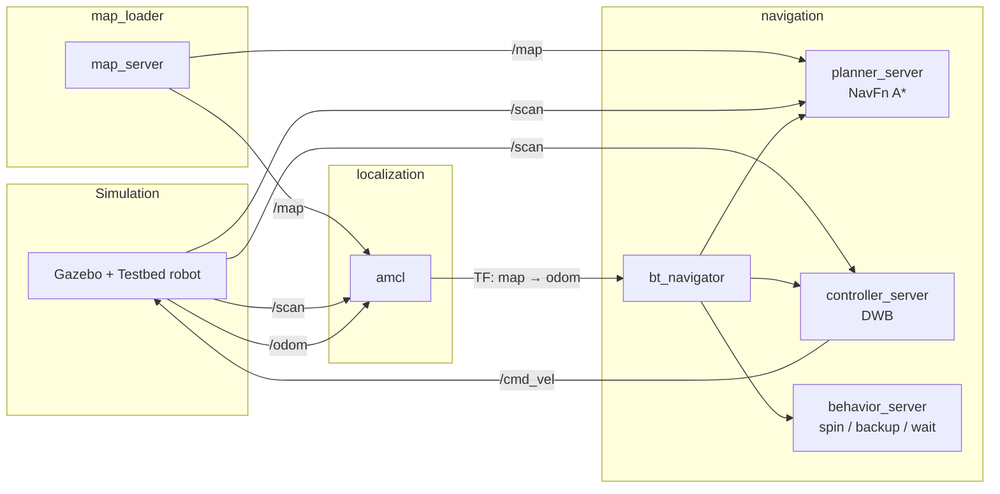
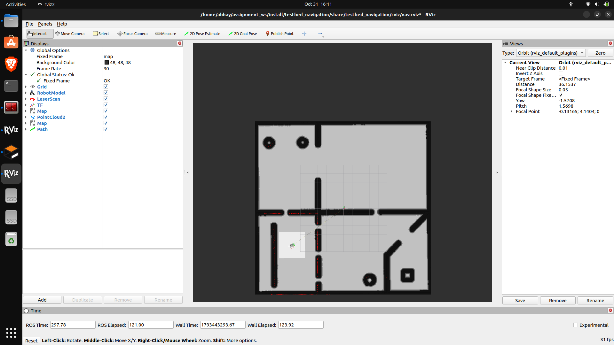
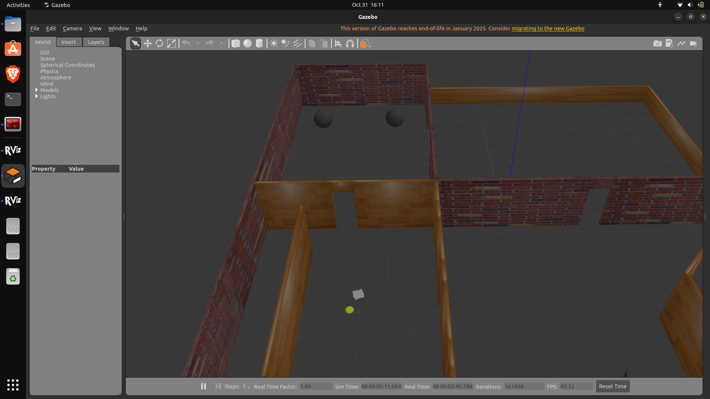
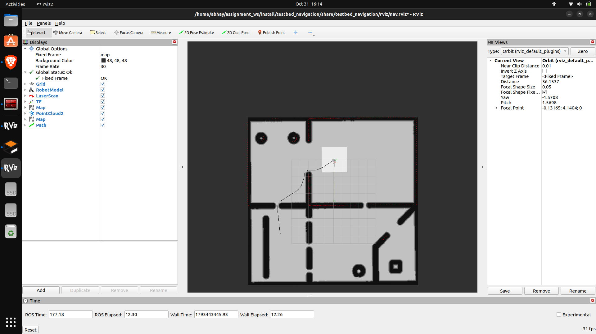

<h1 align="center">🤖 testbed_navigation</h1>

<p align="center">
  Manual Nav2 bringup for the <b>Testbed-T1.0.0</b> robot<br>
  <i>ROS 2 Humble · Gazebo Classic · Nav2</i>
</p>

<p align="center">
  
  
  
  
</p>

---

## 📖 Overview

Instead of calling `nav2_bringup`, this package launches each stage of the
navigation pipeline **separately**, with its own Nav2 nodes and its own
parameter file:

1. **Map loading**: `map_server`
2. **Localization**: `amcl`
3. **Navigation**: planner, controller, behaviors and the behavior-tree navigator

Each stage is its own launch file, so it can be started, tested and debugged
independently.

🎥 **[Watch the demo video](https://drive.google.com/file/d/18tG7JNXljzrSA6WD_bYht6zO0zo6gSEl/view?usp=sharing)**

---

## 🗂️ Package contents

| File | Purpose |
|---|---|
| `launch/map_loader.launch.py` | `map_server` + lifecycle manager; loads `testbed_bringup/maps/testbed_world.yaml` |
| `launch/localization.launch.py` | `amcl` + lifecycle manager; initial pose set by launch arguments |
| `launch/navigation.launch.py` | `controller_server`, `planner_server`, `behavior_server`, `bt_navigator` + lifecycle manager; optional RViz |
| `config/amcl_params.yaml` | AMCL parameters |
| `config/nav2_params.yaml` | Planner, controller, costmaps, behaviors, BT navigator |
| `rviz/nav.rviz` | RViz layout (Fixed Frame `map`, costmaps, plans, particles) |
| `docs/` | Screenshots used in this README |

---

## 🧩 Architecture



---

## 🚀 How to run

**Requirements:** ROS 2 Humble, Gazebo 11, and Nav2.

```bash
sudo apt install ros-humble-navigation2 ros-humble-nav2-bringup
cd ~/assignment_ws
colcon build --symlink-install
source install/setup.bash
```

Open four terminals (source the workspace in each) and start them **in this order**:

| # | Stage | Command |
|---|---|---|
| 1 | Simulation | `ros2 launch testbed_bringup testbed_full_bringup.launch.py` |
| 2 | Map | `ros2 launch testbed_navigation map_loader.launch.py` |
| 3 | Localization | `ros2 launch testbed_navigation localization.launch.py` |
| 4 | Navigation | `ros2 launch testbed_navigation navigation.launch.py rviz:=true` |

Wait for `Managed nodes are active` in each terminal before starting the next.

Then set goals with the **2D Goal Pose** tool while RViz's **Fixed Frame is `map`**.

### Launch arguments

| Launch file | Argument | Default | Description |
|---|---|---|---|
| `localization` | `initial_x`, `initial_y`, `initial_yaw` | `0.0`, `5.0`, `0.0` | Robot start pose in `map` (the Gazebo spawn pose) |
| `localization` | `params_file` | `config/amcl_params.yaml` | AMCL parameter file |
| `navigation` | `rviz` | `false` | Open RViz with `rviz/nav.rviz` |
| `navigation` | `params_file` | `config/nav2_params.yaml` | Nav2 parameter file |
| all | `use_sim_time` | `true` | Use Gazebo's `/clock` |

If the robot is **not** at its spawn pose when localization starts, pass its real pose:

```bash
ros2 launch testbed_navigation localization.launch.py initial_x:=2.0 initial_y:=3.0 initial_yaw:=1.57
```

---

## ⚙️ Design choices

| Component | Choice | Why |
|---|---|---|
| Map | `nav2_map_server` + lifecycle manager (autostart) | Standard, minimal map loading |
| Localization | AMCL, differential motion model, likelihood-field laser model | Fits a differential-drive robot with a 2D lidar |
| Global planner | NavFn with **A\*** (`use_astar: true`) | Direct paths on a small, mostly-known map |
| Local controller | DWB over a rolling-window local costmap | Basic, robust obstacle avoidance |
| Costmap inflation | `inflation_radius: 0.35`, `cost_scaling_factor: 10.0` | Cost drops quickly away from walls, so paths stay short while clearing obstacles |
| Behavior tree | Default Nav2 navigate-to-pose tree | Spin, backup and wait recoveries from `behavior_server` |
| Footprint | Circle, `robot_radius: 0.2` | Estimated from the URDF |

Only basic navigation is configured, as the task asks, so `velocity_smoother`
and `collision_monitor` were left out.

**Frames:** `map → odom → base_footprint`; scan on `/scan`, odometry on `/odom`,
velocity commands on `/cmd_vel`.

---

## 🐞 Bugs found in the starter code

The full list is in [`BUGS.txt`](../BUGS.txt) at the repository root.

| # | File | Problem | Fix |
|---|---|---|---|
| 1 | `testbed_description/CMakeLists.txt` | `ament_package` without parentheses, so the build failed | `ament_package()` |
| 2 | `testbed_bringup/maps/testbed_world.yaml` | `image:` pointed to a file that doesn't exist | `image: testbed_world.pgm` |
| 3 | `testbed_description/urdf/testbed.gazebo` | Lidar `range_max` of 1.5 m is too short to localize on a ~20 m map | Raised to 12.0 m |
| 4 | `testbed_bringup/CMakeLists.txt` | `maps/` was never installed, so `map_server` failed with "bad file" | Added `maps` to the install rule |

---

## 🧗 Challenges

- **Goal frame and TF timestamps.** Goals sent while RViz's Fixed Frame was
  `odom` worked for a few seconds, then failed with "extrapolation into the
  past" errors, because the goal's timestamp aged out of the TF buffer during
  re-planning. Using Fixed Frame `map` for goals and pose estimates fixed it.
- **AMCL start pose.** Starting AMCL with a pose different from the robot's real
  pose made `map → odom` jump by metres and the scan drift off the walls.
  The simulated odometry is in the Gazebo world frame and the map is aligned
  with it, so the start pose is now a launch argument defaulting to the spawn pose.
- **Lifecycle startup.** Nav2 nodes only become active when a lifecycle manager
  configures them, and AMCL needs the map first, so the launch order matters.
- **Install rules.** The map was invisible to `map_server` until the `maps`
  directory was installed.

---

## 🛠️ Troubleshooting

| Symptom | Likely cause | Fix |
|---|---|---|
| `Frame [map] does not exist` in RViz | Map and AMCL not running yet | Start `map_loader`, then `localization` |
| Scan doesn't line up with the walls | AMCL started at the wrong pose | Restart localization with the real pose, or use **2D Pose Estimate** |
| Goal fails with `extrapolation into the past` | RViz Fixed Frame is `odom` | Set Fixed Frame to `map` |
| Map is blank in RViz | Wrong durability setting | Set the Map display's Durability to **Transient Local** |
| Gazebo won't start / `Entity [testbed] already exists` | An old simulation is still running | `pkill -9 gzserver gzclient` and relaunch |

---

## 📸 Results

🎥 **[Demo video](https://drive.google.com/file/d/18tG7JNXljzrSA6WD_bYht6zO0zo6gSEl/view?usp=sharing)**

### Localization: scan aligned with the map



AMCL starts from the robot's spawn pose (`initial_x/y/yaw` launch arguments),
and the laser scan (red) lies on the walls of the map.

### Simulation world



### Path planning



The NavFn planner (A\*) routes the robot through the doorway to a goal in
another room, and DWB follows the path until the goal is reached.

---

<p align="center">
  Author: <b>Abhay Potdar</b>
</p>